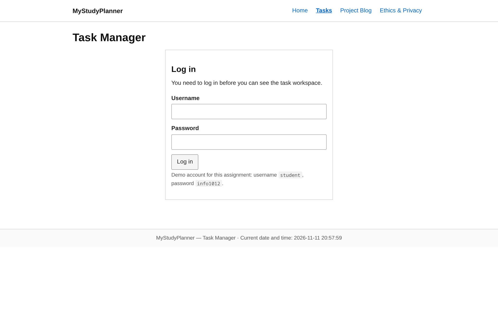
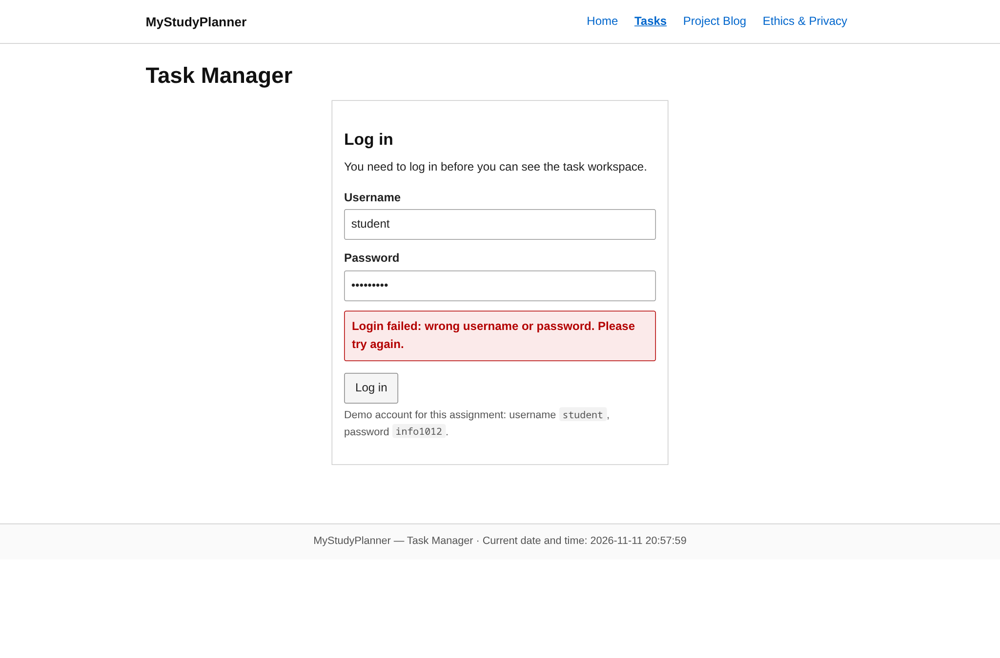
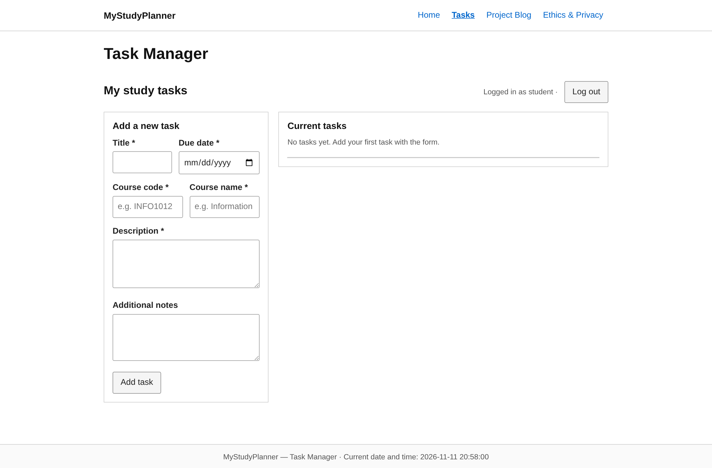
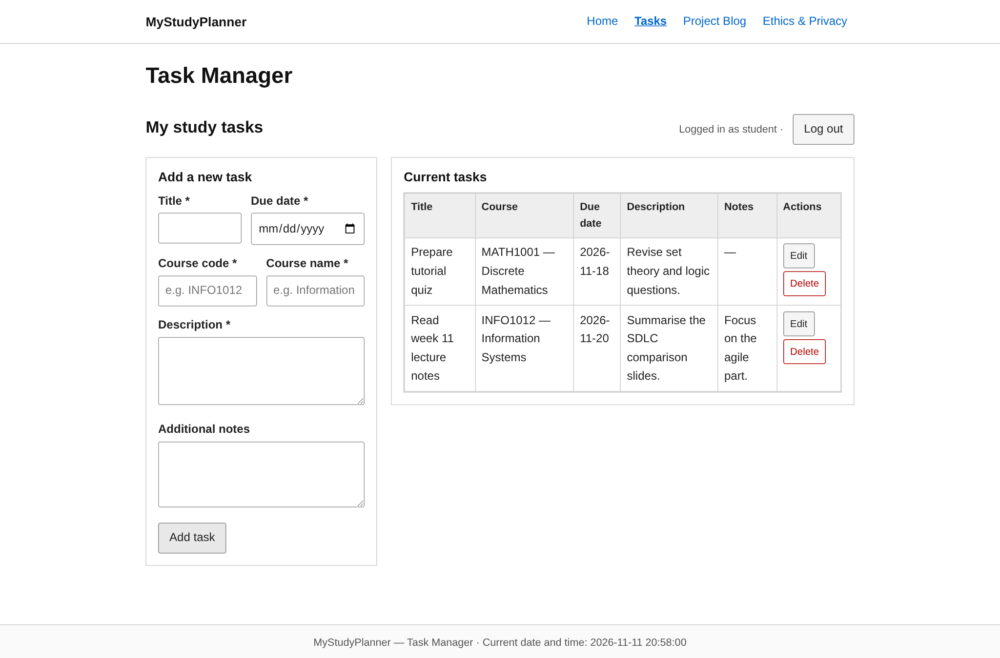
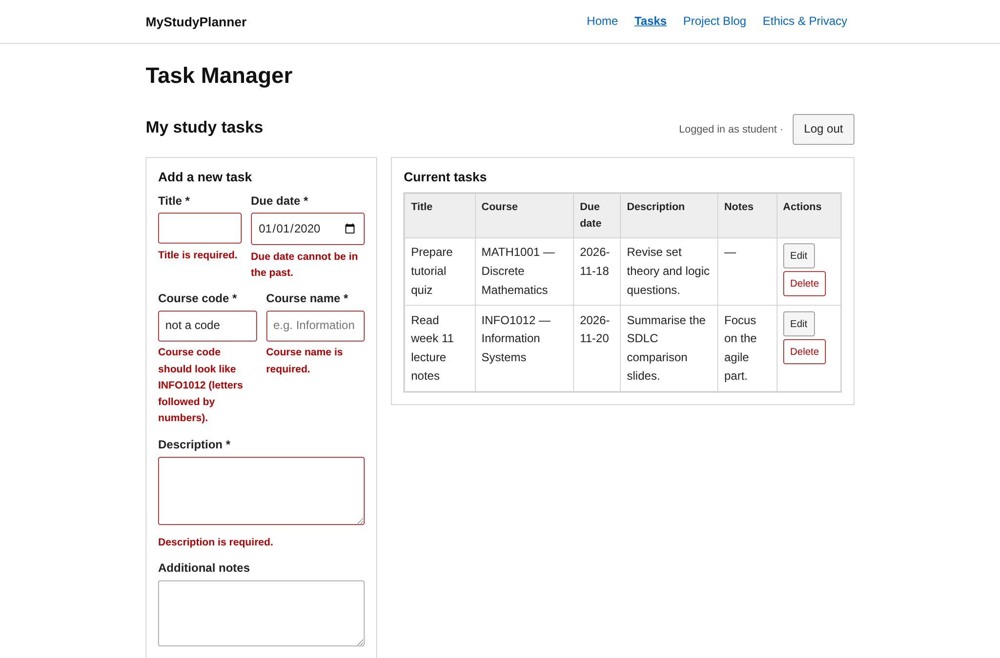
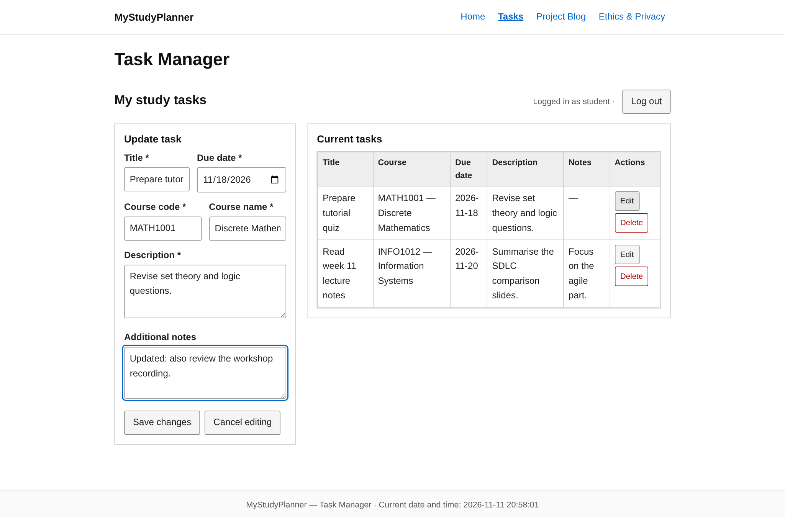
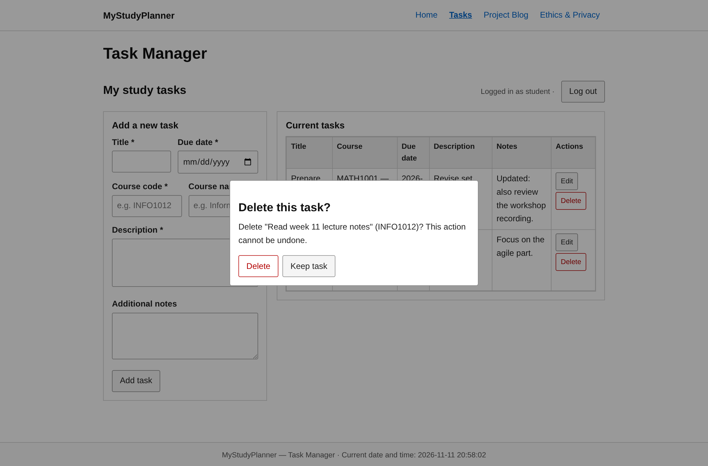
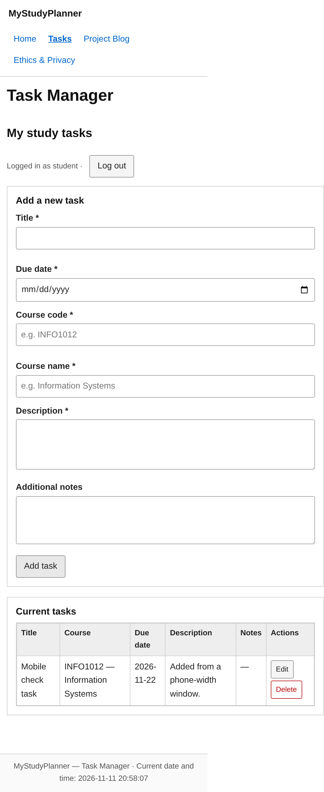

# MyStudyPlanner

**Repository URL:** https://github.com/Liu194-afk/MyStudyPlanner

A small website for keeping track of course tasks and deadlines. Built for INFO1012 Assignment 3 with plain HTML, CSS and JavaScript - no frameworks and no build step.

## Project description

MyStudyPlanner keeps every study task in one table: title, course code, course name, due date, description and extra notes. The task page needs a login, all input is checked with clear error messages, deletes ask for confirmation first, and all data stays in the browser's localStorage. The site has four pages:

| Page | What it does |
|---|---|
| `index.html` | Home: app intro, About the App / About Me, image carousel with Prev/Next and auto-cycle buttons |
| `tasks.html` | Task manager behind a login: create, view, update, delete (with confirmation dialog), input validation |
| `blog.html` | Three-week sprint plan, Agile practices, and a debugging log with before/after evidence |
| `ethics.html` | Ethics & privacy reflection, matched to how the site is actually built |

## Installation and running

No build step and no dependencies - plain HTML/CSS/JS.

1. Clone or download this repository, then unzip it if needed.
2. Option A — just open `index.html` in a browser.
3. Option B (recommended, behaves like the real site) — serve the folder:
   ```bash
   cd MyStudyPlanner
   python3 -m http.server 8000
   # then open http://localhost:8000
   ```

Tested in Chromium-based browsers on desktop (1366px) and mobile (390px) widths.

## How to use

1. **Home** - read About the App / About Me; use **Prev / Next** to switch images, or let the carousel cycle by itself and press **Pause** to stop it.
2. **Tasks** - log in with the demo account: username `student`, password `info1012`.
3. **Add a task** - fill in title, course code (e.g. `INFO1012`), course name, due date, description and optional notes, then press **Add task**. Empty required fields and past/invalid dates are rejected with an error message.
4. **Update a task** - click **Edit** on a row; the form fills in and the button becomes **Save changes**; press **Cancel editing** to stop without saving.
5. **Delete a task** - click **Delete** and confirm in the dialog (it names the task, and **Keep task** is focused by default).
6. **Log out** - ends the session and hides the workspace again. Tasks stay saved in localStorage for the demo user.

## Supported features

- Login gate (session-based; the workspace is not reachable when logged out)
- Create / read / update / delete for tasks, saved in localStorage per user
- Validation: required fields, course-code format, valid calendar date, no past due dates - each with its own message
- Delete-confirmation dialog (keyboard friendly, Escape closes it)
- Image carousel: Prev / Next / auto-cycle with pause, `aria-live` status text
- Current date and time in the footer of every page (updated every second)
- Responsive layout (single column below 860px) and `prefers-reduced-motion` support

## Screenshots

| | |
|---|---|
|  |  |
|  |  |
|  |  |
|  |  |

More screenshots (home page, carousel, ethics page, mobile home) are in `docs/screenshots/`; bug-fix evidence is in `docs/evidence/` and discussed in `blog.html`.

## Credits

See [CREDITS.md](CREDITS.md). In short: all images are self-drawn course assets; fonts are system fonts; code is original with MDN/lecture references noted in the blog.

## License

Released under the MIT License — see [LICENSE](LICENSE).
